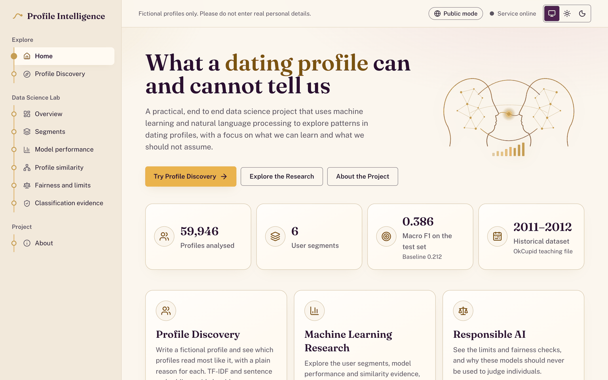
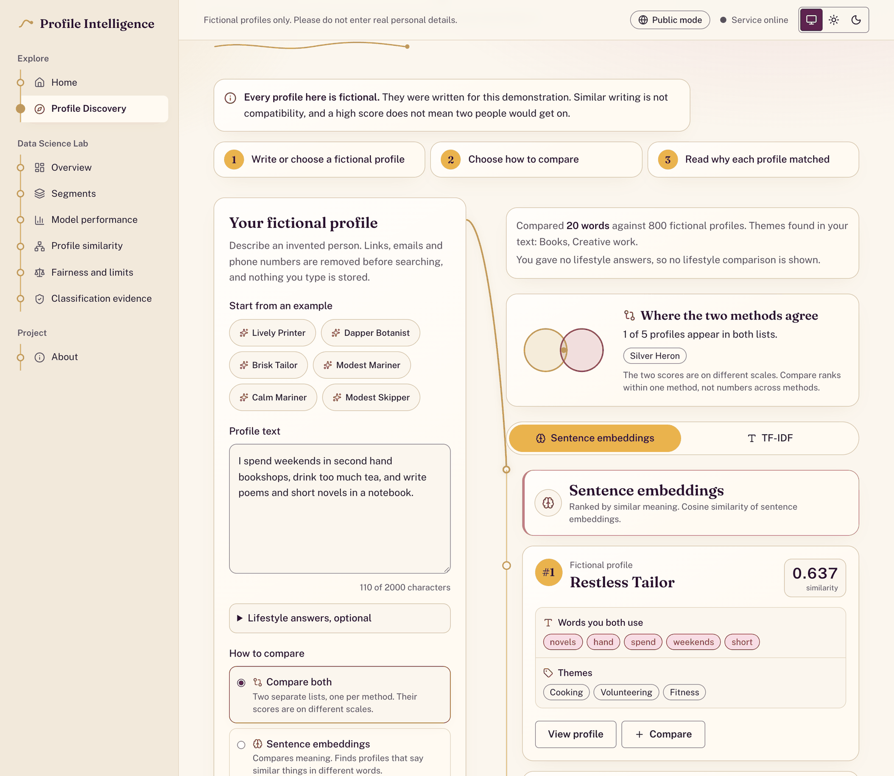
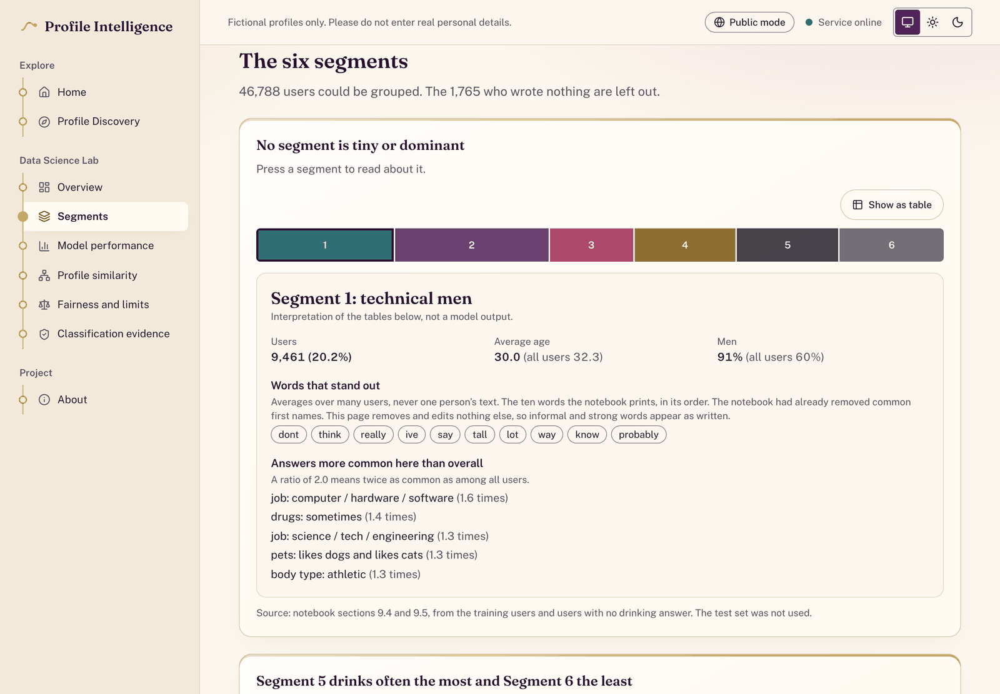
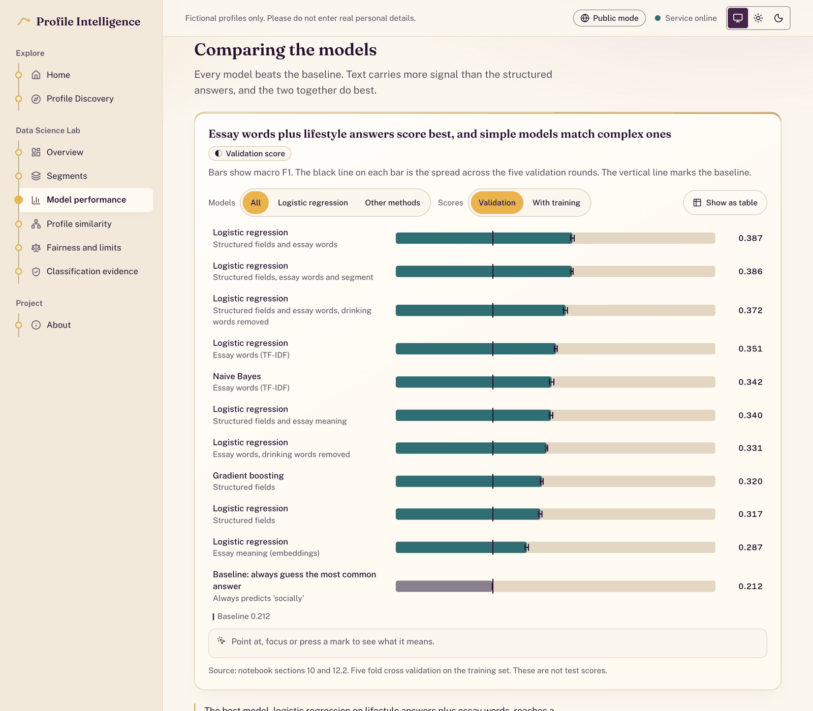
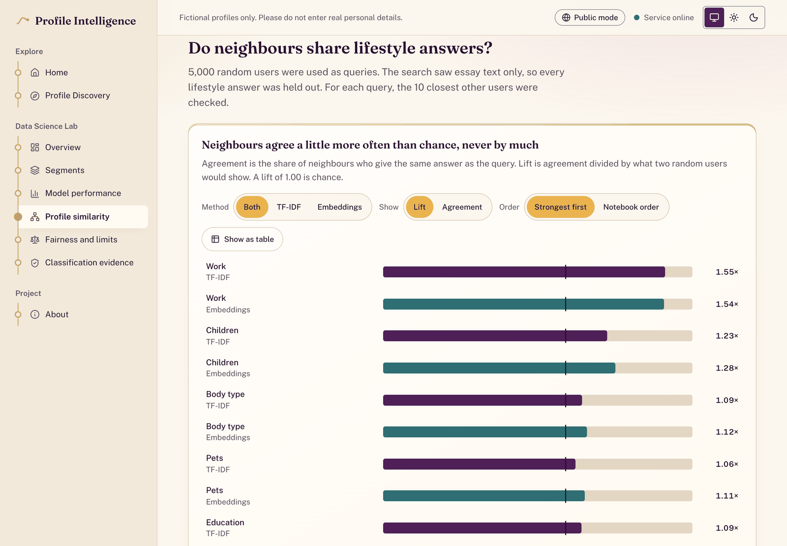
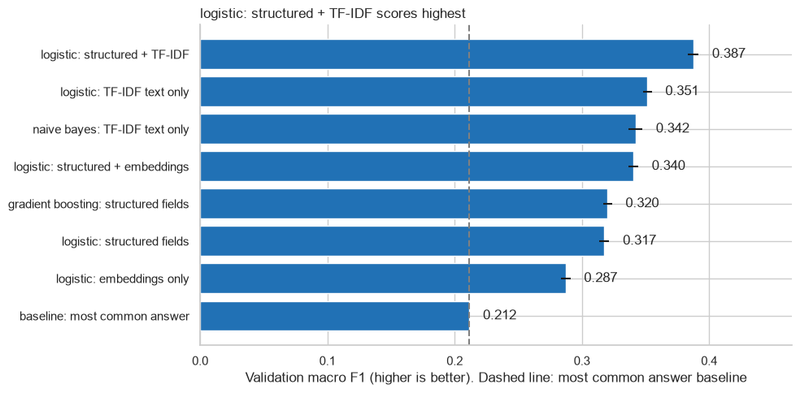
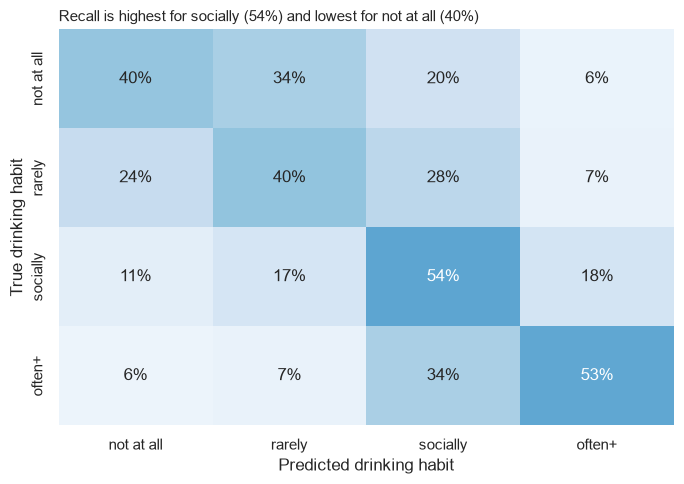
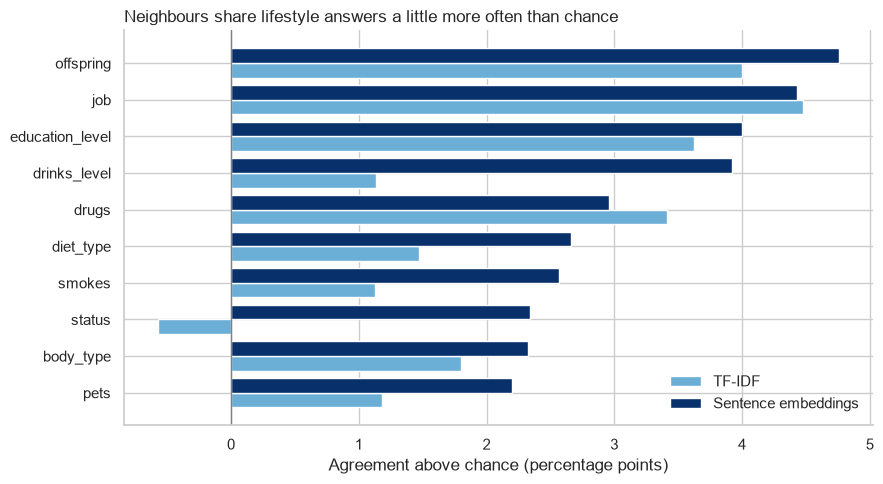
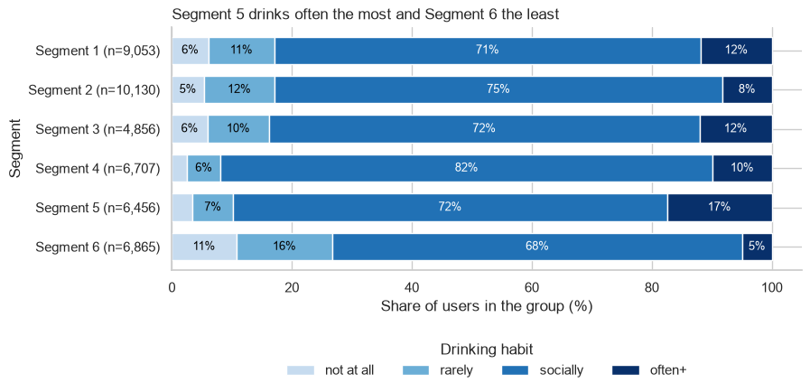
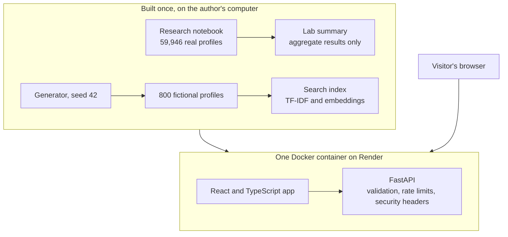

# Profile Intelligence: NLP Powered Dating Profile Analytics

[](https://profile-intelligence.onrender.com)


Can the words in a dating profile tell us how someone lives? This project answers with evidence: a full data science study of 59,946 profiles, and a live web application that lets you try the methods on fictional people.

### [Launch the live application](https://profile-intelligence.onrender.com)

The site runs on a free hosting plan. If nobody has visited for a while, the first page can take around 80 seconds to wake up. After that it responds in a fraction of a second.

[](https://profile-intelligence.onrender.com)

## Project overview

A new user on a dating platform has no history, so the platform has only the profile to work with, and many profiles are incomplete. How much can the profile text and lifestyle answers tell us, and where does the signal run out? The study asks three questions:

1. **Segmentation.** Can meaningful user groups be discovered from what people write and how they describe their lives?
2. **Prediction.** Can a missing drinking habit be predicted from the rest of the profile, and does knowing a user's segment help?
3. **Similarity.** Can NLP find profiles that are alike, and how do TF-IDF and sentence embeddings compare?

**The answer in one paragraph.** What people write carries real but limited information about how they live. Essays predict a drinking habit better than guessing (macro F1 of 0.386 against 0.212 on a held out test set) and find similar profiles slightly better than chance. User segments are only weakly separated, and the data cannot show whether two people would match.

**What is in this repository**

| Part | What it is |
|---|---|
| [`okcupid_profile_intelligence.ipynb`](okcupid_profile_intelligence.ipynb) | The complete analysis in 15 sections, from the problem and ethics to the model card and future work |
| [`app/`](app) | The web application: a FastAPI service and a React and TypeScript front end, with tests and deployment files |
| [`OKCupid_Data_Science_Portfolio_Presentation.pptx`](OKCupid_Data_Science_Portfolio_Presentation.pptx) | A 12 slide presentation of the findings |

## Key findings

| Question | Result | How it was measured |
|---|---|---|
| Can essays and answers predict drinking? | **Modestly.** Macro F1 of **0.386** (95% range 0.376 to 0.397) against **0.212** for always guessing "socially" | 11,393 held out users, the test set used once |
| Where does the signal come from? | Structured fields alone score 0.317, essay text alone 0.351, both together **0.387** | 5 fold cross validation on 45,568 training users |
| Does clustering help prediction? | **No.** Adding the segment changes the score by -0.0017, within the noise | Same 5 folds |
| Are there distinct user types? | **Six stable but weakly separated segments.** Agreement 0.98 across new random starts and 0.97 across new samples, silhouette score about 0.05 | K-means on reduced embeddings and lifestyle answers |
| Which similarity method is better? | **Embeddings find similar lifestyles slightly better, TF-IDF predicts better.** Neighbours share lifestyle answers 2.2 to 4.8 points more often than chance with embeddings, for example job: 12.6% against 8.2% | 5,000 query users, 10 neighbours each, answers the search never saw |
| Is the model fair to subgroups? | Macro F1 is 0.393 for women and 0.381 for men, but **0.327 for users aged 45 and over** and **0.275 for users with no text** | Test set, by subgroup |

The model finds 54% of social drinkers, 53% of frequent drinkers, 41% of rare drinkers and 40% of non drinkers. Its accuracy (0.517) is below the baseline (0.734) on purpose: it gives up accuracy on the large group to find the small ones, and precision for the three small groups is only 0.17 to 0.28. It is a modest signal, not a tool for judging individuals.

## The application

Every profile in the public application is **fictional**. The application never shows a real person, and nothing a visitor types is stored.

### Profile Discovery
Write or choose a fictional profile and see the most similar profiles from a pool of 800 invented ones. TF-IDF and sentence embeddings are shown side by side, each with its own list and scale, with the shared words and themes that explain every match.



### User Segmentation
Six segments, each with the words and answers that set it apart. The page states the limits plainly: the segments are stable but blend into one another, and they describe tendencies, not types of people.



### Model Performance
Every model compared against the baseline, with training, validation and test scores kept apart so that overfitting is visible.



### Profile Similarity
The proxy evaluation: do profiles with similar essays also give similar lifestyle answers? The page shows the lift over chance for each field and method.



## Exploratory analysis and machine learning visualisations

Four figures from the notebook, shown as the notebook produced them.



**Model comparison** (notebook section 10.5). Logistic regression on structured fields plus TF-IDF text scores highest at 0.387 on validation data. Every model beats the 0.212 baseline, and text carries more signal than the structured answers.



**Final model on the test set** (section 12.3). Recall is highest for "socially" (54%) and lowest for "not at all" (40%). Most mistakes go to the neighbouring group.



**TF-IDF against sentence embeddings** (section 11.3). Neighbours agree a little more often than chance, never by much. Embeddings lead on most fields, and TF-IDF leads on job and drugs.



**Segment sizes and drinking habits** (section 9.5). Drinking was never used to build the segments, so this is a check on them. Segment 5 drinks often the most and Segment 6 the least.

## Machine learning methodology

1. **Clean, then split once.** Fixed cleaning rules, then a stratified split with seed 42: 45,568 training users and 11,393 test users. A further 2,985 users without a drinks answer are used only for unsupervised work.
2. **Training data only.** Exploration, hypothesis tests, preprocessing and model fitting use the training set. Everything that learns from data sits inside a scikit-learn pipeline, so nothing leaks from the test set.
3. **Text.** Essays are cleaned of markup and contact details, then represented two ways: TF-IDF (20,000 columns) and sentence embeddings (`all-MiniLM-L6-v2`, 384 dimensions, run locally).
4. **Segmentation.** K-means on reduced embeddings (20 components) and lifestyle answers (15 components), with the number of groups chosen by stability, because the inertia curve has no clear bend and the silhouette score never passes 0.085.
5. **Prediction.** The target is the drinking habit in four groups. A majority class baseline, logistic regression, Naive Bayes and gradient boosting are compared with 5 fold cross validation. Macro F1 is the metric because 73.3% of users answer "socially", so plain accuracy would reward ignoring the small groups. The test set is used once, for the final model and the baseline.
6. **Similarity.** Nearest neighbours by cosine similarity, evaluated by whether neighbours share lifestyle answers that the search never saw, compared with chance.
7. **Checks.** Bootstrap intervals on the test scores, subgroup performance, and an assessment of what the results do not show.

**Limitations.** The data is from California in 2011 and 2012, answers are self reported, and `sex` has two values. There are no matches, messages or ratings, so similarity is evaluated with a proxy, and nothing here shows that similar profiles would match. Results are associations, not causes. The fairness checks are not a full audit.

## Technology stack

| Layer | Tools |
|---|---|
| Analysis and machine learning | Python 3.12, pandas, NumPy, SciPy, scikit-learn, matplotlib, seaborn, Jupyter |
| NLP | TF-IDF, sentence embeddings (`sentence-transformers`, `all-MiniLM-L6-v2`), PyTorch |
| Back end | FastAPI, Pydantic, uvicorn |
| Front end | React 19, TypeScript, Vite, Tailwind CSS, TanStack Query |
| Quality | pytest (389 backend tests), Vitest, Playwright browser tests in Chrome, WebKit and an iPhone profile, axe accessibility scans, ruff, ESLint |
| Delivery | Docker (multi stage build), Render |

## System architecture



* **One container, one origin.** The API and the built web app are served together by a single process, with the models and the search index baked into the image at build time.
* **Two modes.** Public mode, the default and the only one deployed, never loads a file derived from the real profiles, switches off the classifier and the API documentation, and refuses settings that would weaken this at start up. Local mode adds an educational demonstration of the drinking classifier.
* **Methods kept honest.** The two similarity methods are never merged into one score, because their scales differ. The lifestyle answers a visitor gives explain a match but never change the ranking.

## Privacy, ethics and limitations

The data is a teaching file of OkCupid profiles scraped in June 2012 (Albert Y. Kim and Adriana Escobedo-Land, 2015, [JSE_OkCupid](https://github.com/rudeboybert/JSE_OkCupid)). The authors obtained OkCupid's permission to share it for teaching. No source says that the individual users agreed.

* **The data is not in this repository.** It stays on the author's computer, together with the drinking classifier and every file built from individual profiles. The repository holds aggregate findings only.
* **The public application contains no real profile.** Its 800 profiles are invented from hand written theme sentences, and a check against 441,351 real essays found no run of seven consecutive words in common.
* **The notebook reports aggregates only.** No essay text and no individual profile rows are displayed.
* **The text identifies people.** Essays contain links, handles and contact details, and 64% of profiles are unique on six ordinary fields, so the data cannot be treated as anonymous. Contact details are removed from anything a visitor types, and nothing a visitor types is stored.
* **Sensitive traits were excluded.** Orientation, religion and ethnicity were never prediction targets and never model inputs.
* **Not for profiling.** This is an educational project. It is not suitable for profiling users, for inferring any sensitive trait, for treating users differently by segment, for decisions about an individual, or for describing a similarity score as compatibility. The model card in notebook section 14.2 lists the prohibited uses.

## Run it locally

**The web application.** It needs Python 3.12 and a current Node.js LTS, and no real data.

```
git clone https://github.com/gbeminiyiprecious721-cmd/okcupid-profile-intelligence.git
cd okcupid-profile-intelligence/app/backend

python3 -m venv .venv
.venv/bin/pip install -r requirements_dev.txt
.venv/bin/python scripts/download_model.py        # once, about 90 MB
.venv/bin/python scripts/build_search_index.py    # a few seconds
.venv/bin/python -m uvicorn profile_api.main:app --port 8000
```

In a second terminal:

```
cd okcupid-profile-intelligence/app/frontend
npm install
npm run dev                                        # http://localhost:5173
```

Run the checks with `.venv/bin/python -m pytest` in `app/backend` and `npm run check` in `app/frontend`. More detail is in [`app/README.md`](app/README.md).

**The research notebook.** Python 3.12 with the pinned packages in `requirements.txt`: pandas 3.1.1, numpy 2.5.4, scikit-learn 1.9.1, matplotlib 3.11.2, seaborn 0.13.2, scipy 1.18.1 and sentence-transformers 6.3.0.

1. Create the environment: `python3 -m venv .venv`, `source .venv/bin/activate`, `pip install -r requirements.txt`.
2. Put `profiles.csv` in the project folder. It is not included. It must be the original 2015 version of the dataset above. The authors' 2021 revision removes location and last online, adds noise to age and shuffles the essays, so it will not reproduce the results.
3. Open `okcupid_profile_intelligence.ipynb` with the kernel of that environment and run all cells. The random seed is 42, so results repeat on the same computer. A clean run took about 16 minutes with five parallel workers and needs about 2 GB of memory per worker. The first run downloads the embedding model, and the text is never sent anywhere.

## Live deployment

The application runs at [profile-intelligence.onrender.com](https://profile-intelligence.onrender.com) on Render's free plan, built from [`app/deploy/Dockerfile.render`](app/deploy/Dockerfile.render) in this repository, with automatic deploys switched off.

* **Same results as the validated research environment.** 60 live searches returned rankings and scores identical to the locally validated results.
* **Hardened for the public.** Strict content security policy and HSTS, 30 searches a minute per visitor, a cap on how many searches run at once to protect the small server, safe error messages that never repeat what was sent, and a scan of the final image that found no private data or credentials.
* **Tested.** 23 production smoke checks pass over HTTPS, and automated accessibility scans pass for WCAG A and AA. Manual screen reader testing has not been done yet.
* **Free plan behaviour.** The service sleeps when idle, so a first visit after a quiet period takes about 80 seconds. A warm search takes around 0.3 seconds.

## Future improvements

* Evaluate similarity against real outcomes such as replies or matches, which this data does not have.
* Try segmentation methods that allow overlapping or uneven groups, since users form a continuum.
* Load the models in the background to shorten the wake up time on the free plan.
* Finish counting visitors reliably behind the host's proxy chain, so the per visitor rate limit is exact.
* Add manual screen reader testing to the automated accessibility checks.

## Licence and data

The original code and text in this repository are released under the MIT licence (see [`LICENSE`](LICENSE)). The data is not included and is not covered by it. No licence is stated for the data. Its authors obtained OkCupid's permission to share it for teaching, on the condition that it remains public, and no source says that the individual users agreed, so check the terms of wherever you obtain the file before any use. The packages and the embedding model (`all-MiniLM-L6-v2`, Apache 2.0) keep their own licences.

This is an independent educational project. It is not affiliated with or endorsed by OkCupid.

Built by Precious Gbeminiyi.
